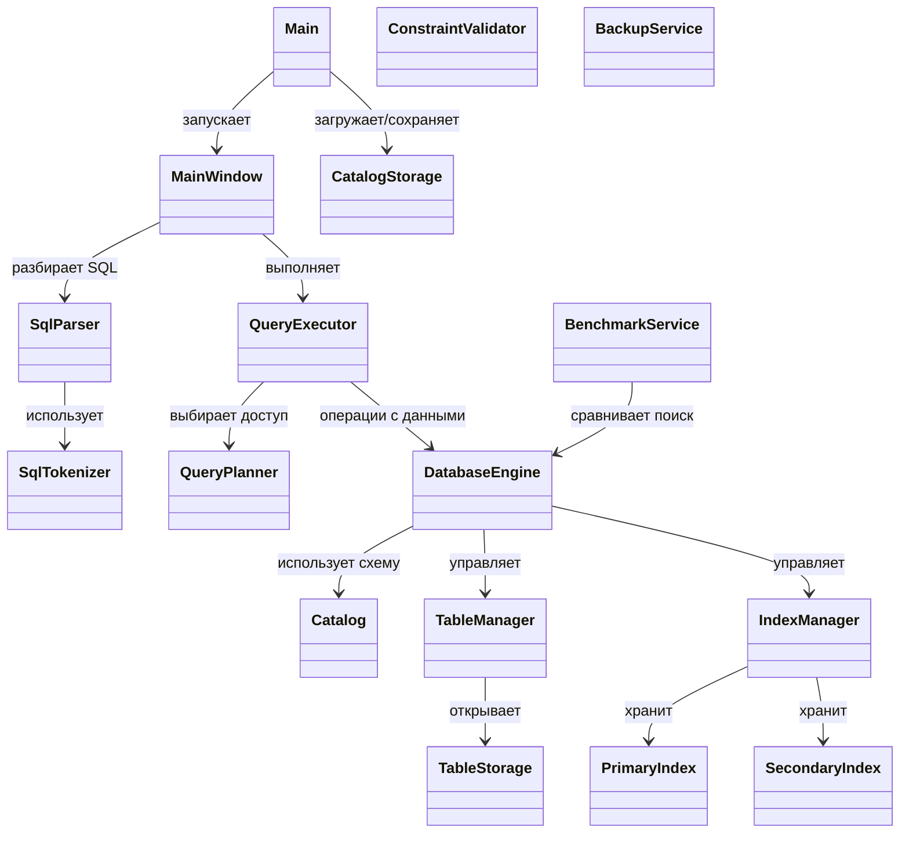
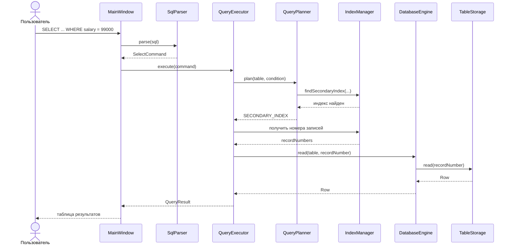

# Mini DBMS на Java

Учебная упрощённая система управления базами данных с дисковым хранением, SQL-подобным языком запросов, индексами и графическим интерфейсом на Java Swing.

Проект выполнен в рамках лабораторной работы № 2 "Разработка упрощённой СУБД на Java".

## Возможности

- Создание и удаление таблиц (`CREATE TABLE`, `DROP TABLE`).
- Типы `INT`, `DOUBLE`, `STRING`, `DATE`, `BOOLEAN`.
- Первичные ключи (`PRIMARY KEY`), уникальные значения (`UNIQUE`), связи между таблицами (`FOREIGN KEY`).
- Вставка одной или нескольких строк (`INSERT INTO`), в том числе с перечислением столбцов.
- Чтение (`SELECT`), изменение (`UPDATE`) и удаление (`DELETE`) с простым условием `WHERE`.
- Создание и удаление вторичных индексов (`CREATE INDEX`, `DROP INDEX`); отдельный первичный индекс.
- Планирование `SELECT` с использованием индекса для равенства по индексированному столбцу и `EXPLAIN SELECT`.
- Хранение таблиц, метаданных, индексов и информации о свободных слотах в файлах.
- Swing-интерфейс с редактором SQL, деревом таблиц, табличным результатом и экспортом результата `SELECT` в Excel (`.xlsx`).
- Сервисы резервного копирования и восстановления ZIP, а также бенчмарка индексов доступны из Java API.
- Автоматизированные тесты на JUnit 5.

## Требования

- **JDK 17 или новее** (код компилируется с `--release 17`).
- **Maven** или IntelliJ IDEA с Maven, встроенным в IDE.

> Важно: корнем проекта является каталог с `pom.xml` папка `lab2` в исходной структуре проекта. Не открывайте внешнюю папку с отдельными файлами `.idea` как независимый модуль.

## Запуск

### IntelliJ IDEA

1. Откройте **File -> Open** и выберите `pom.xml`.
2. Разрешите импорт Maven-проекта и дождитесь загрузки зависимостей.
3. Откройте `src/main/java/lab/Main.java`.
4. Запустите метод `main`. Появится графическое окно с редактором SQL и таблицей результатов.

### Командная строка

Из каталога с `pom.xml`:

```bash
mvn clean compile
mvn exec:java
```

Данные хранятся в папке `database/` относительно текущей рабочей директории. Папка создаётся при необходимости. Для постоянного хранения запускайте программу из одной и той же рабочей директории.

## Быстрый пример: две связанные таблицы

Запросы можно вводить в SQL-редактор по одному. Полный пример находится в [`examples/demo.sql`](examples/demo.sql).

```sql
CREATE TABLE departments (
    id INT PRIMARY KEY,
    name STRING UNIQUE
);

CREATE TABLE employees (
    id INT PRIMARY KEY,
    name STRING,
    salary DOUBLE,
    hired DATE,
    active BOOLEAN,
    department_id INT,
    FOREIGN KEY (department_id) REFERENCES departments(id)
);

INSERT INTO departments VALUES (1, 'Engineering'), (2, 'Finance');
INSERT INTO employees VALUES (1, 'Name1', 95000.0, '2026-09-01', TRUE, 1);
INSERT INTO employees (id, name, salary, hired, active, department_id)
VALUES (2, 'Name2', 86000.0, '2026-09-15', TRUE, 2);

SELECT * FROM employees;
SELECT name, salary FROM employees WHERE salary > 80000;
UPDATE employees SET salary = 99000 WHERE id = 1;
DELETE FROM employees WHERE id = 2;
```

### Индексирование

```sql
CREATE INDEX idx_employees_salary ON employees (salary);
EXPLAIN SELECT * FROM employees WHERE salary = 99000;
SELECT * FROM employees WHERE salary = 99000;
DROP INDEX idx_employees_salary;
```

Первичный ключ уникален. Внешний ключ проверяет наличие соответствующей записи в другой таблице. Удаление родительской записи, на которую ссылаются дочерние записи, отклоняется.

## Архитектура

Проект разделён на слои:

| Пакет | Назначение |
|---|---|
| `lab.catalog` | Схемы таблиц, метаданные и их сериализация |
| `lab.sql.tokenizer` | Выделение SQL-токенов |
| `lab.sql.parser`, `lab.sql.ast`, `lab.sql.condition` | Построение и представление SQL-команд |
| `lab.sql.executor` | Выполнение SQL-команд, формирование результатов |
| `lab.engine` | Управление таблицами и индексами, планирование запросов |
| `lab.storage` | Файлы таблиц, записи и сериализация значений |
| `lab.index` | Первичные и вторичные индексы, свободные слоты |
| `lab.constraint` | Проверка ограничений целостности |
| `lab.service` | Резервное копирование, бенчмарк, Excel |
| `lab.gui`, `lab.cli` | Графический и консольный интерфейсы |

### Диаграмма классов



Это **упрощённая архитектурная диаграмма основных классов**, а не полный UML всех 51 исходных файлов.

### Диаграмма последовательности: SELECT с индексом



### Файловое хранение

Рабочая директория базы организована так:

```text
database/
|── catalog.meta        # схемы таблиц и метаданные индексов
|── tables/            # записи таблиц (*.db)
|── indexes/           # первичные и вторичные индексы (*.idx)
|── free/              # сведения о свободных слотах (*.free)
```

При штатном завершении приложения сохраняется каталог и закрываются файловые структуры. При следующем запуске загружаются каталог, таблицы и индексы. Отдельный `BackupService` позволяет создавать и восстанавливать ZIP-снимки базы; сервис следует использовать при закрытых файлах БД.

## Тестирование

JUnit-тесты находятся в `src/test/java` и проверяют разбор SQL, CRUD, ограничения, индексы, сохранение данных и ZIP-резервное копирование.

В IntelliJ откройте папку `src/test/java`, нажмите **Run Tests in 'java'**. Альтернатива в терминале:

```bash
mvn test
```

Пример запуска отдельного теста:

```bash
mvn -Dtest=BackupServiceTest test
```

## Сравнение производительности поиска

В проекте есть `BenchmarkService`, который сравнивает полный проход по таблице с поиском по вторичному индексу, предварительно проверяя совпадение результатов двух способов.

Чтобы получить воспроизводимые измерения, запустите `IndexPerformanceReportTest` в IntelliJ или командой:

```bash
mvn -Dtest=IndexPerformanceReportTest test
```

Тест строит таблицы на **1 000 и 5 000 записей**, использует вторичный индекс по `rating`, ищет `rating = 42.0`; перед измерением выполняется прогрев, затем **15 повторений** каждого способа. Результаты печатаются в формате Markdown.

**Проверочный запуск:** Linux, OpenJDK 21, 15 измерений после прогрева; результаты получены фактическим запуском `IndexPerformanceReportTest` в тестовой среде (не на компьютере автора проекта). Для собственной конфигурации можно повторить измерения и обновить таблицу.

| Число записей | Полный перебор, мс | По индексу, мс | Ускорение |
|---:|---:|---:|---:|
| 1 000 | 3.7756 | 0.0438 | 86.24× |
| 5 000 | 8.1407 | 0.0749 | 108.62× |

Замеры зависят от файловой системы, JDK, нагрузки компьютера и состояния кеша ОС; для оценки ускорения используется отношение средних времён.

## Резервное копирование

`lab.service.BackupService` предоставляет два метода: `createBackup(Path)` и `restoreBackup(Path)`. Резервный ZIP-файл необходимо располагать **вне** директории базы. Восстановление проверяет структуру архива и сначала распаковывает его во временную директорию, затем заменяет текущую директорию БД. Класс проверяется в `BackupServiceTest`.

**Это Java API, а не команда SQL или кнопка GUI**. Для создания и восстановления копий следует закрыть базу, чтобы избежать несогласованности файлов.

## Выводы

В ходе лабораторной работы реализована учебная реляционная СУБД на Java с файловым хранением данных и метаданных, собственным SQL-подобным парсером, индексированием и проверкой ограничений. Решение демонстрирует работу первичных и вторичных индексов, выбор способа доступа к данным и восстановление сохранённой базы при повторном запуске. 

## Использованные источники

1. [Java Platform API Documentation](https://docs.oracle.com/en/java/javase/17/docs/api/) - файловый ввод-вывод, коллекции, Swing.
2. [Apache Maven Documentation](https://maven.apache.org/guides/) - сборка и зависимости.
3. [JUnit 5 User Guide](https://junit.org/junit5/docs/current/user-guide/) - модульное тестирование.
4. [Apache POI](https://poi.apache.org/) - экспорт Excel-файлов.
